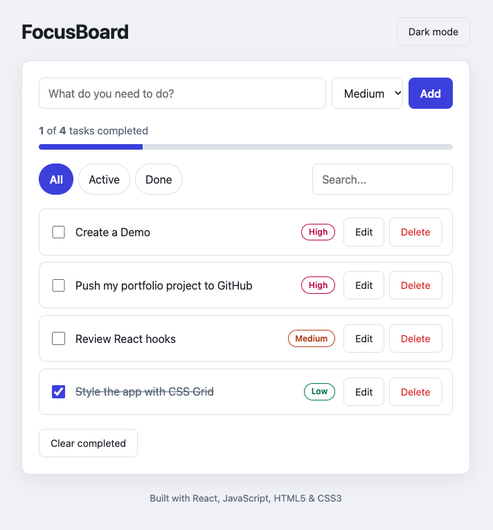

# FocusBoard

A clean, accessible task manager built with **React**, **JavaScript (ES6+)**, **HTML5** and **CSS3**. I built it to practice component-based design, state management with hooks, and responsive styling.

**Live demo:** https://leonardosv18.github.io/Focusboard---React/ 

 

## Features

- Add, edit, complete and delete tasks
- Priority levels (low, medium, high) shown as colored badges
- Filter by All / Active / Done, plus live search
- Progress bar showing how many tasks are completed
- Light and dark theme
- Data saved in the browser with `localStorage`, so it survives refreshes
- Responsive layout (desktop and mobile)
- Keyboard friendly and screen-reader friendly (labels, ARIA attributes, visible focus)

## Tech stack

| Technology | How it is used |
| --- | --- |
| **React 18** | Components, props, `useState`, `useEffect`, `useMemo` |
| **JavaScript (ES6+)** | Array methods (`map`, `filter`), destructuring, spread, modules |
| **HTML5** | Semantic elements (`header`, `main`, `section`, `footer`), forms, labels |
| **CSS3** | Custom properties, Grid, Flexbox, media queries, dark theme |
| **Vite** | Fast dev server and production build |

## What I practiced

- **Custom hook:** `useLocalStorage` wraps `useState` and syncs with `localStorage`.
- **Lifting state up:** `App` owns the data; child components receive props and callbacks.
- **Derived state:** the visible list is computed with `useMemo` instead of being stored twice.
- **Immutable updates:** tasks are updated with `map`, `filter` and the spread operator.
- **Accessibility:** form labels, `aria-pressed` on filter buttons, `role="progressbar"`, `role="alert"` for errors.
- **Theming:** CSS variables switched through a `data-theme` attribute.

## Project structure

```
focusboard/
├── index.html
├── package.json
├── vite.config.js
└── src/
    ├── main.jsx
    ├── App.jsx
    ├── styles.css
    ├── hooks/
    │   └── useLocalStorage.js
    └── components/
        ├── TaskForm.jsx
        ├── TaskItem.jsx
        ├── FilterBar.jsx
        └── Stats.jsx
```

